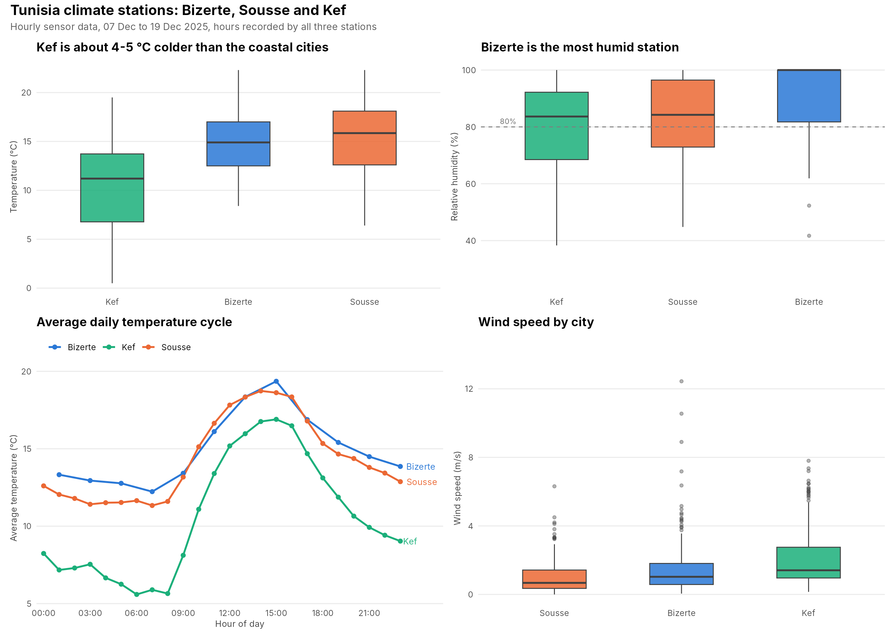
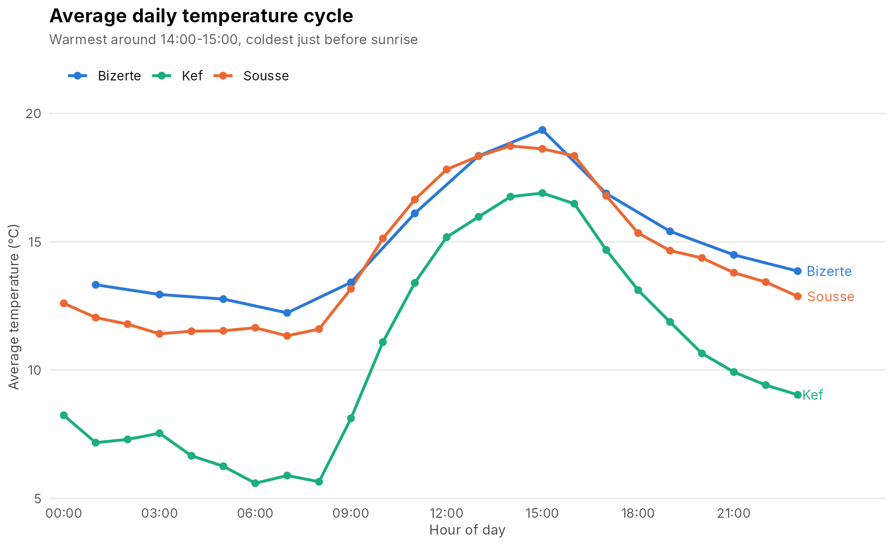
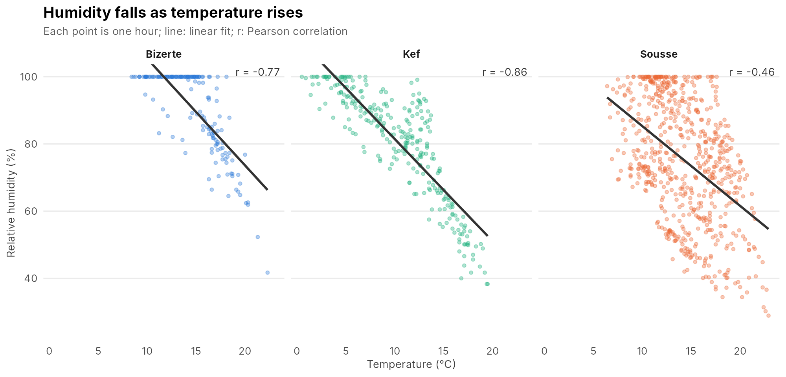

# Tunisia Climate Analysis – Bizerte, Sousse and Kef


Comparison of hourly weather-station data from three Tunisian cities, two on the coast (Bizerte, Sousse) and one inland (Kef), in December 2025. An R pipeline loads the raw sensor exports, cleans them, detects faulty sensors, compares the stations and publishes the results as a Quarto website.

**Website:** https://mohamed-jarboui.github.io/tunisia-climate-analysis/



## Key findings

Compared on the period all three stations recorded (7 to 19 December 2025):

| | Bizerte | Sousse | Kef |
|---|---|---|---|
| Mean temperature | 14.7 °C | 15.4 °C | **10.5 °C** |
| Minimum temperature | 8.4 °C | 6.4 °C | **0.5 °C** |
| Mean daily range (max − min) | n/a* | 8.9 °C | **12.1 °C** |
| Mean relative humidity | **90.3 %** | 83.3 % | 79.9 % |
| Mean wind speed | 1.6 m/s | 1.0 m/s | 2.1 m/s |

\* Bizerte logs about every two hours, so it has no complete days to measure a daily range.

- **Kef, inland, is about 4 to 5 °C colder** than the coastal cities and is the only station that went below 5 °C (40 hours).
- **Kef has the largest day-night swing**; the sea keeps coastal temperatures steadier.
- **Bizerte is the most humid**, above 80 % relative humidity in 78 % of its hours.
- **Humidity moves opposite to temperature** at all three stations (correlation −0.46 to −0.86): highest around sunrise, lowest around 15:00 when temperatures peak.

<p>
  
  
</p>

## Data quality checks

The cleaning step does more than reshape the data:

- **Faulty sensor detection.** A working solar sensor reads about 0 W/m² at night. Kef's sensor reports 945 to 958 W/m² around the clock (median night reading 954 W/m²), so its solar values are flagged and excluded. Without this check, Kef would appear to get ten times more sunlight than the coast.
- **Timestamp parsing.** Readings logged a few seconds late (`07:00:02`) are rounded to the hour. Midnight timestamps lose their time part when converted to text; handling them correctly recovered 310 readings that were silently dropped before.
- **Fair comparison.** The stations cover different dates (Sousse continues until 6 January), so cities are compared only over their common period.
- **Range checks** for physically impossible values (none found) and partial days excluded from daily statistics.

## Data

- **Source:** [Tunisia Open Data Portal](https://catalog.data.gov.tn), dataset *Capteur d'environnement de la station climatique*
- **Stations:** Bizerte (168 hourly records, 7 to 19 Dec 2025), Kef (281, 7 to 19 Dec 2025), Sousse (664, 7 Dec 2025 to 6 Jan 2026)
- **Variables:** temperature, relative humidity, dew point, wind speed and direction, solar radiation, pressure

## Project structure

```
├── data/raw/                 # original station exports (CSV, long format)
├── scripts/
│   ├── 01_data_loading.R     # read and combine the three stations
│   ├── 02_data_cleaning.R    # timestamps, reshape, range checks, sensor fault detection
│   ├── 03_eda.R              # city comparison, daily cycle, correlations, extremes
│   └── 04_visualizations.R   # figures
├── output/
│   ├── figures/              # PNG figures
│   └── tables/               # CSV result tables
├── index.qmd, analysis.qmd,  # Quarto website pages
│   visualizations.qmd, about.qmd
├── docs/                     # rendered website (served by GitHub Pages)
└── run_all.R                 # runs the four scripts in order
```

## Reproduce

Requires R (4.x) and [Quarto](https://quarto.org).

```bash
git clone https://github.com/Mohamed-jarboui/tunisia-climate-analysis.git
cd tunisia-climate-analysis
Rscript requirements.R     # install packages
Rscript run_all.R          # data -> figures and tables (a few seconds)
quarto render              # build the website into docs/
```

## Limitations

- About two to four weeks of winter data: the results describe December 2025, not the cities' climate. Seasonal patterns and long-term trends cannot be studied with this sample.
- One station per city, so each result reflects that station's exact location.
- Humidity sensors cap at 100 %; 73 % of Bizerte's night-time readings are exactly 100 %.

## Author

Mohamed Jarboui – Data Science and AI engineering, École Polytechnique de Sousse
